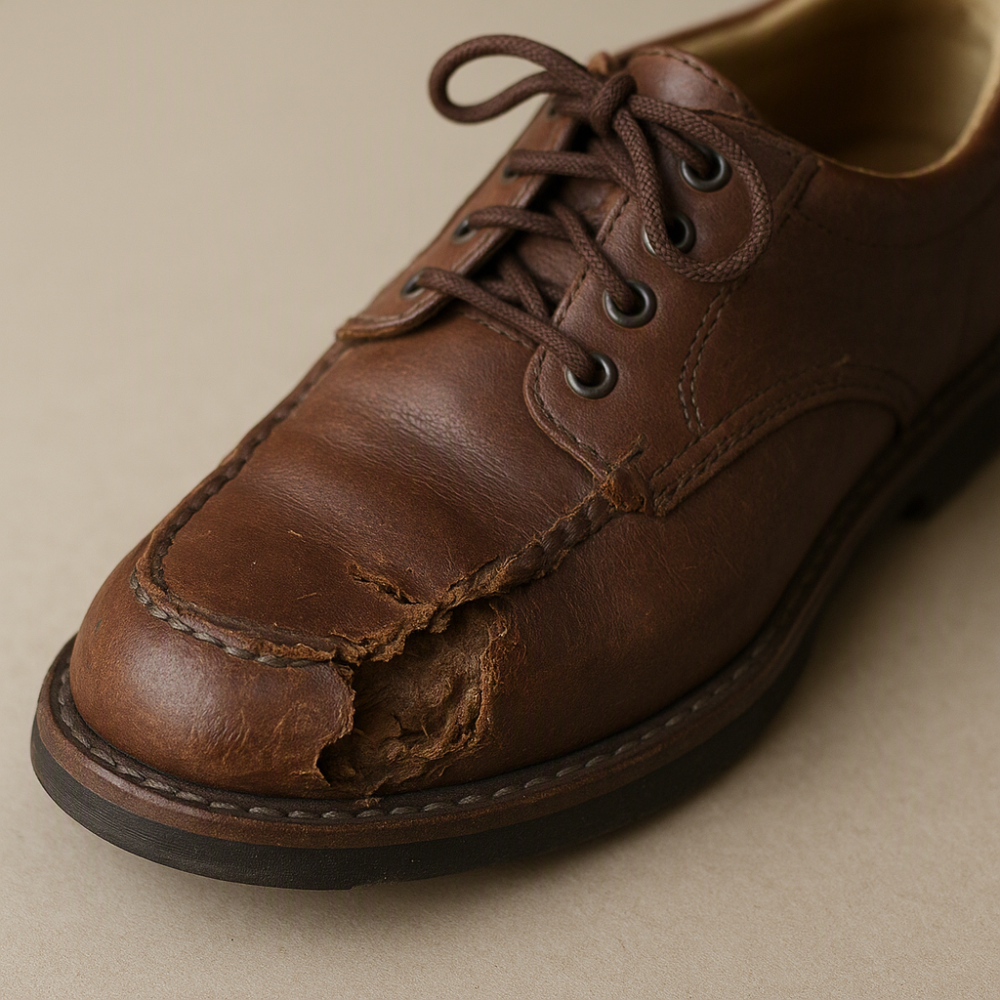
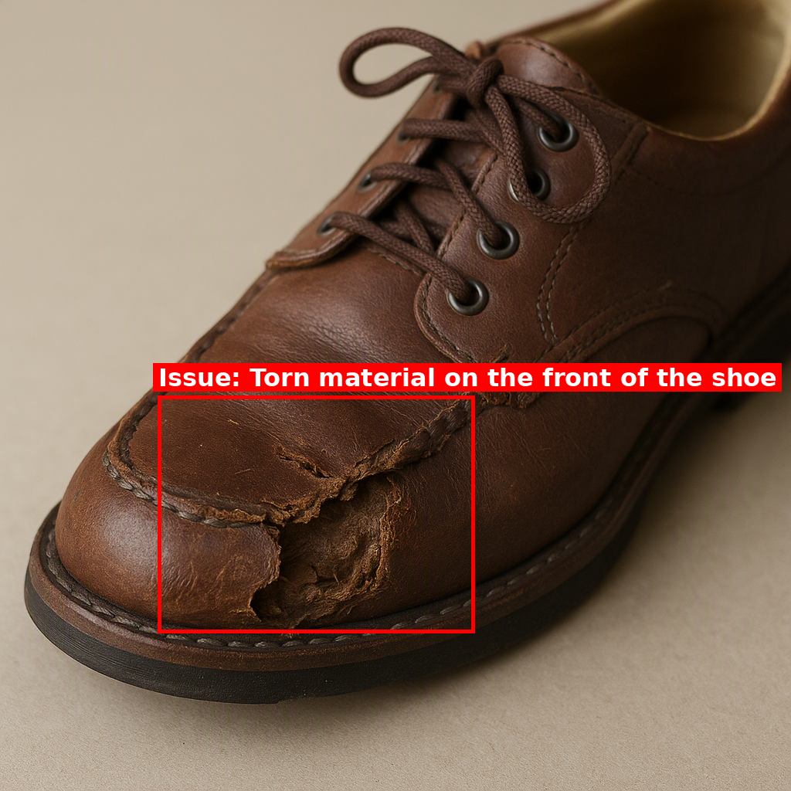

# Azure Complaint Classifier

[](https://doi.org/10.5281/zenodo.23354088)

A multimodal generative AI pipeline on **Azure OpenAI** that turns a customer's **spoken complaint** into a **categorized support ticket with visual evidence**. It transcribes the audio, generates an image of the reported problem, has a vision model describe the image and locate the issue, draws a box around it, and classifies the complaint into a product category and subcategory.

*Udacity Azure Generative AI Engineer Nanodegree, Project 3: Customer Complaint Classification*

| Generated image | Annotated issue |
|---|---|
|  |  |

> **Customer 2:** *"…the shoe is completely ruined, the material is torn and there is significant damage to the front…"*
> **Classified as:** Fashion > Shoes & Accessories

## How it works

```
audio/customerN/audio.mp3
   │
   ▼  whisper.py   Whisper            → transcription.txt
   ▼  dalle.py     prompt builder     → image_prompt.txt
   ▼  dalle.py     gpt-image-1-mini   → generated_image.png
   ▼  vision.py    GPT-4o (vision)    → image_description.txt  (description, issue, bounding box)
   ▼  vision.py    Pillow             → annotated_image.png
   ▼  gpt.py       GPT-4o + catalog   → classification.txt     (category / subcategory / reason)
   ▼  main.py      orchestration      → summary.json, all_results.json
```

| File | Role |
|---|---|
| `main.py` | Runs the six steps for every recording in `audio/` and saves each intermediate result |
| `whisper.py` | `transcribe_audio()`: speech-to-text with Whisper |
| `dalle.py` | `create_image_prompt()` and `generate_image()`: builds a photo-style prompt and saves the generated image |
| `vision.py` | `describe_image()` and `annotate_image()`: GPT-4o returns a description, the issue, and a bounding box as JSON, then Pillow draws a labeled box |
| `gpt.py` | `classify_with_gpt()`: picks a category/subcategory from `categories.json` with JSON-mode output and checks the pair actually exists in the catalog |
| `config.py` | Loads the endpoint, key, deployment names, and API versions from `.env`, and creates the Azure OpenAI client |

## Results

| | Customer 1 | Customer 2 |
|---|---|---|
| Complaint | New shoes arrived with torn material and damage to the front | Same issue, separate recording |
| Issue found by vision model | Torn material and significant damage to the front of the shoe | Torn material on the front of the shoe |
| Classification | **Fashion > Shoes & Accessories** | **Fashion > Shoes & Accessories** |

Every output is in [`output/customer1/`](output/customer1) and [`output/customer2/`](output/customer2):
`transcription.txt` · `image_prompt.txt` · `generated_image.png` · `image_description.txt` · `annotated_image.png` · `classification.txt` · `summary.json`

## Run it yourself

**Azure setup:** one Azure OpenAI / AI Foundry resource with three deployments: `whisper`, `gpt-image-1-mini`, and `gpt-4o`. East US 2 offers all three.

```bash
git clone https://github.com/Rei0322/azure-complaint-classifier
cd azure-complaint-classifier
cp .env.example .env          # then add your endpoint and key
pip install -r requirements.txt
python main.py                # all complaints
python main.py customer1      # or just one
```

Each module can also be run alone for testing, for example `python gpt.py`.

## Design decisions

- **gpt-image-1-mini instead of DALL-E 3.** DALL-E 3 was no longer available to deploy, and gpt-image-1-mini is its current replacement. `dalle.py` handles both response formats (URL or base64), so either model works.
- **Structured outputs.** The vision and classification steps ask for JSON, so the bounding box and category can be used directly in code. The classifier also checks its answer against `categories.json` and flags any invented category.
- **Grounding the image prompt.** The prompt asks for a realistic product photo focused on the defect, with no text or faces, so the vision step has a clear issue to find.
- **Secrets stay out of the repo.** The endpoint and key load from `.env`, which `.gitignore` excludes. `.env.example` shows the format.
- **Cost-aware testing.** `python main.py customer1` runs a single complaint. A full run costs a few cents, mostly for the image generation.

## Lessons learned

- A Foundry **project** URL (`…services.ai.azure.com/api/projects/…`) is not the same as the resource's **Azure OpenAI endpoint** (`…openai.azure.com/`). The SDK needs the second one, or it returns `API version not supported`.
- Lab subscriptions can cap deployment size by policy (here, a 10K tokens-per-minute limit), so deployments had to be sized down to pass.
- Model availability varies by region. Whisper and the image models are only offered in a few regions, so region choice comes before anything else.

## Tech stack

Python · Azure OpenAI (Whisper, gpt-image-1-mini, GPT-4o) · Azure AI Foundry · OpenAI Python SDK · Pillow · python-dotenv

## License

MIT. See [LICENSE](LICENSE). Starter code structure and audio samples are from Udacity's course materials.
